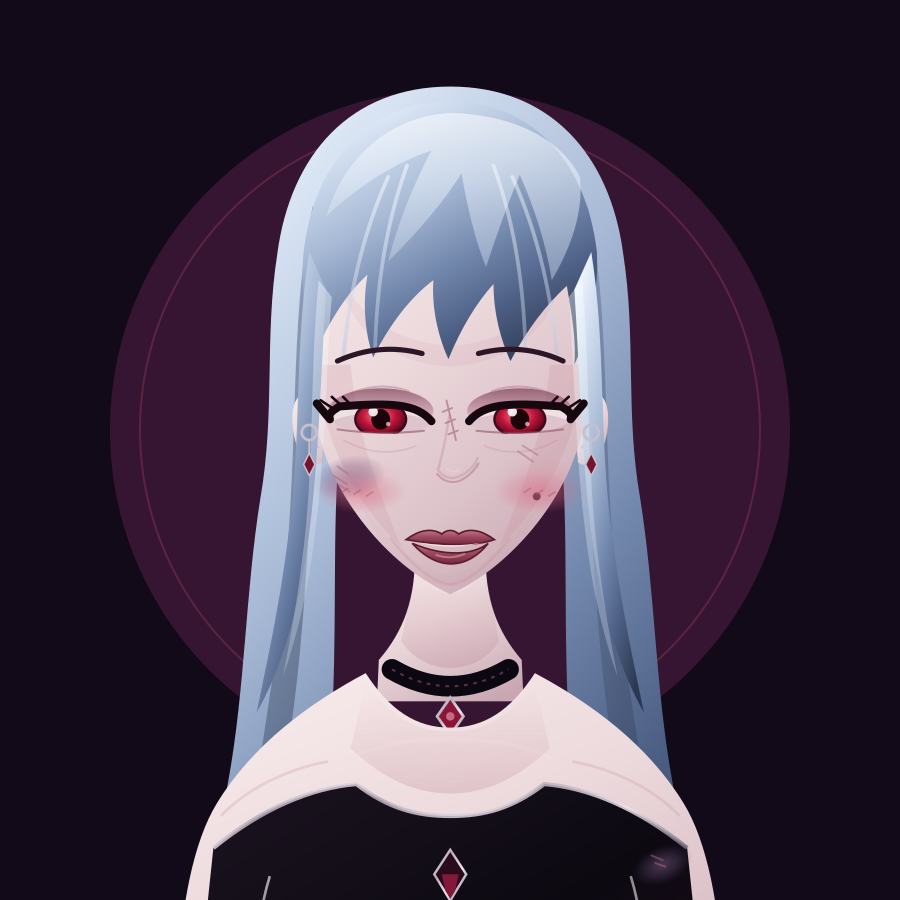

# DRACY: NOCTURNE

A story-first dark fantasy visual novel about an ordinary person, an unusual online friendship, and a door that should not exist.

**Current milestone:** M01 — Project Foundation + Playable Prologue  
**Status:** playable in Godot 4.4.1; optional AI backend tested independently  
**Audience:** adults 18+



## What is playable now

- A complete 10–15 minute prologue, **The Girl Behind the Screen**
- 134 authored dialogue lines, 54 meaningful choices, 22 scenes, and two endings
- A diegetic online messaging interface that transitions into visual-novel presentation
- Ten Dracy expressions with consistent layered character art
- Five independent relationship dimensions and persistent player boundaries
- Story flags, choice history, conditional reactions, prerequisites, and event triggers
- Autosave, three manual slots, load/delete controls, checksum validation, backup recovery, and save migrations
- Main menu, 18+ confirmation, settings, transcript, memory/privacy panel, and character archive
- Original atmospheric music, rain ambience, UI sounds, backgrounds, poses, and outfit studies
- Fully offline authored playthrough and scripted post-prologue conversation
- Optional provider-independent AI conversation through a secure TypeScript backend

Chapter 01 and later chapters are **not implemented**. The game does not pretend otherwise.

## Requirements

- **Godot 4.4.1 or newer** (standard build, not .NET)
- Windows, Linux, or macOS desktop
- Optional backend: **Node.js 22.6+** and npm

Validated in this environment with Godot `4.4.1.stable.official.49a5bc7b6` and Node `v26.13.0`.

## Run the game

1. Open Godot.
2. Choose **Import**, then select `game/project.godot`.
3. Open the project and press **F5** or **Run Project**.

Command line:

```bash
godot --path game
```

No internet connection or AI service is required.

### Controls

- **Click / Space / Enter:** advance dialogue or finish typewriter text
- **1–3 or mouse:** select an authored choice
- **Top bar:** transcript, save, load, memory/privacy, settings, main menu
- **Escape:** currently reserved for future pause-menu behavior; use the visible Menu button

## Tests

### Game

```bash
godot --headless --path game --script res://tests/run_tests.gd
godot --headless --path game res://tests/smoke_playthrough.tscn
```

The first command validates narrative references, relationships, saves, migrations, recovery, pending-choice restoration, and complete authored routes. The second builds the real UI, plays the prologue through the presentation coordinator, opens every panel, tests offline chat, and reloads the completed autosave.

### Backend

```bash
cd backend
npm ci
npm test
npm run typecheck
```

## Optional AI backend

The authored game never calls an AI provider directly. The client can only call your backend.

```bash
cd backend
npm ci
copy .env.example .env       # Windows
# cp .env.example .env       # Linux/macOS
```

Set a strong `SESSION_SECRET` in `.env`. To enable a real provider, set `AI_BASE_URL`, `AI_MODEL`, and `AI_API_KEY`. Without those values, the backend still works using validated scripted fallback replies.

```bash
npm start
```

Then open **Settings** in the game, enable **Optional AI conversation**, and keep the public backend URL (default `http://127.0.0.1:8787`). Never put a provider API key in the game.

See [`docs/ai-backend.md`](docs/ai-backend.md) for the API, memory model, security boundaries, and production notes.

## Project structure

```text
game/
  scenes/                 Main menu, VN coordinator, reusable UI panels
  scripts/
    core/                 State, saves, settings, audio, localization
    narrative/            Data-driven engine, conditions, validation
    ai/                   Backend-only client and response checks
    ui/                   Presentation components
  content/
    chapters/             Authored prologue data
    dialogue/             Offline conversation fallbacks
    narrative_catalog.json
  assets/                 Original art/audio, licensed fonts
  localization/           JSON locale catalogs
  tests/                  Narrative tests and real-scene smoke playthrough
  tools/                  Reproducible art/audio generators
backend/
  src/                    HTTP API, auth, validation, memory, provider adapter
  content/                Approved Dracy conversation canon
  tests/                  Node test suite
design/                   Character bible, world lore, asset manifest
docs/                     Architecture, narrative authoring, reports, logs
```

## Authoring and extension

- Narrative content lives in JSON, not large dialogue scripts.
- `game/scripts/narrative/narrative_validator.gd` rejects broken scene, choice, flag, expression, effect, and choice-history references before play.
- Localization can override any line with `line.<line_id>` and any choice with `choice.<option_id>` in `game/localization/<locale>.json`.
- Art and audio can be regenerated with `python tools/generate_art.py` and `python tools/generate_audio.py` from inside `game/`.

Read [`docs/narrative-system.md`](docs/narrative-system.md) before adding chapters.

## Security and privacy

- No API keys or provider credentials exist in the game client.
- Saves are local, versioned, checksummed, and recoverable.
- The backend authenticates short-lived pseudonymous sessions, rate-limits requests, validates all client context, and rejects unsafe model output.
- AI output cannot mutate story flags, relationship values, boundaries, memories, or chapter progression.
- Players can inspect and delete authored memories or all local save data.
- No cloud database or account system is used in M01.

## Art and licensing

All character, environment, UI, music, and sound assets are original project assets. No anime character designs, Mobile Legends artwork, logos, music, or extracted game assets are included.

Cormorant Garamond and Inter are distributed under the SIL Open Font License; their license files are in `game/assets/fonts/`. See [`design/asset-manifest.json`](design/asset-manifest.json) and [`LICENSE`](LICENSE).

## Known scope limits

M01 does not include later chapters, voice acting, cloud saves, complete long-term AI memory, multiplayer, monetization, mobile release, a wardrobe editor, or a packaged Windows installer. The current art is an original stylized vector production style, not final painted anime key art. A live third-party AI provider was not called because no provider credentials were supplied; the provider adapter, safety guard, fallback path, and API integration are covered by automated tests.
